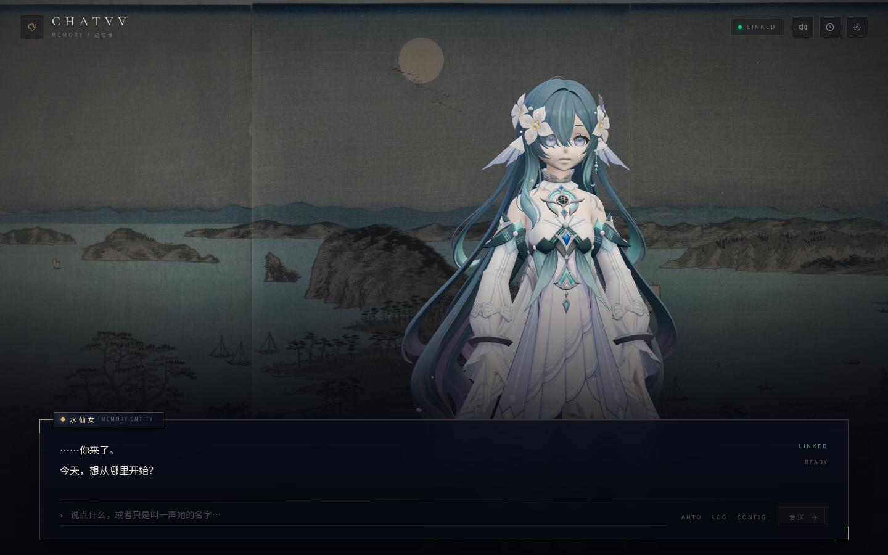

# chatvv web

> **ARCHIVED 2026-10-31.** 旧版 Web GalGame 前端，已由 Flutter app 取代；不再维护。
> 3D 模型已移到 `../galgame-assets/`，本目录只保留源码和背景。
> 归档说明见 [ARCHIVED.md](ARCHIVED.md)。


GalGame 风格的前端：Astro 7 + Vue 3 + Tailwind CSS 4 + Three.js + TypeScript。



## 现在有什么

- 3D 角色舞台：默认直接加载 `Vodyanitsa.pmx`（MMD 标准 PMX，519 骨骼 / 50 表情），GLB 作为备用；固定机位、鼠标视差、呼吸/头部晃动/眨眼。
- 模型注册表：`src/models.ts`，设置面板或 `?model=` 切换 PMX / GLB，切换后自动重载。
- GalGame 对话层：名字牌、打字机、点击立即显示、AUTO/LOG/CONFIG、移动端适配。
- SSE 对话：直接消费后端 `/v1/turns` 的 `response.*` 事件，断线由页面刷新兜底。
- TTS：edge-tts sidecar，回复完成后自动朗读；Web Audio `AnalyserNode` 驱动口型。
- 表情：`にっこり`、`にこり`、`なごみ` 作为基础表情；`まばたき` 定时眨眼。
- 设置：声音、自动朗读、音量、后端地址、TTS 地址，持久化到 localStorage。
- 历史：从后端 `/v1/messages` 拉取最近 30 条，LOG 面板查看。

## 运行

需要三个进程（可以分别开终端）：

```bash
# 1) 后端
./build/dev/chatvvd --config config/config.toml

# 2) TTS
tools/.venv/bin/python tools/edge_tts_server.py --port 8010

# 3) 前端
cd web
pnpm install
pnpm dev
```

打开 http://127.0.0.1:4321/ 。

首次装 TTS 依赖：

```bash
python3 -m venv tools/.venv
tools/.venv/bin/pip install -r tools/requirements.txt
```

## 环境变量

前端默认连本机；部署时用环境变量覆盖：

```bash
PUBLIC_API_BASE=http://192.168.1.20:8080 \
PUBLIC_TTS_BASE=http://192.168.1.20:8010 \
pnpm build
```

也可以在 CONFIG 面板里改，值会存到 localStorage。

## 调试参数

| URL | 作用 |
|---|---|
| `?demo=1` | 加载后自动发一句“你好，初次见面。” |
| `?tts=0` | 关闭自动朗读（截图/无 TTS 环境） |
| `?panel=settings` | 直接打开设置面板 |
| `?panel=history` | 直接打开历史面板 |
| `?debug=1` | 显示模型/状态诊断和打字机进度 |
| `?model=glb` / `?model=pmx` | 覆盖模型选择 |
| `?mat=toon` | PMX 改用 MMD toon 材质（默认 physical） |
| `?expr=0` | 关闭基础表情，便于看原始脸 |
| `?mouth=0.8` | 强制口型开合，调 morph 用 |
| `?arm=22&forearm=25` | 覆盖手臂 / 前臂角度 |

## 结构

```
src/
├── pages/index.astro          Astro 壳
├── components/
│   ├── GameShell.vue          编排：状态、SSE、TTS、面板、顶栏
│   ├── CharacterStage.vue     canvas 宿主
│   ├── DialogueBox.vue        打字机、输入、AUTO/LOG/CONFIG
│   ├── SettingsPanel.vue      模型/声音/连接设置
│   └── HistoryPanel.vue       对话记录
├── models.ts                  模型注册表（PMX / GLB）
├── composables/
│   ├── useChat.ts             SSE 解析、历史拉取、错误降级
│   └── useTts.ts              edge-tts 请求、AudioBuffer、Analyser
└── three/
    └── CharacterStage.ts      three.js 场景、骨骼、morph、口型
```

## 模型与动画

默认模型是 MMD 标准的 `Vodyanitsa.pmx`：

- 40,933 顶点、519 骨骼、13 个材质、50 个表情 morph、6 张实际引用的贴图。
- 没有 VMD/VPD 动作；绑定姿势在 A-pose 附近。
- 表情完整：`あ / い / う / え / お`、`まばたき`、`にっこり`、`にこり`、`なごみ` 等。
- 直接加载：`@moeru/three-mmd` 的 `MMDLoader`，不经过 GLB 转换。
- 材质：默认 `MMDPhysicalMaterial`（跟随场景灯光/环境）；`?mat=toon` 可切回 MMD toon。

GLB 备用：`arcore.glb`，575 骨骼；材质有缺失，只作为 PMX 加载失败时的 fallback。
模型清单在 `src/models.ts`；加模型只需放好文件 + 加一条记录。

处理方式：

1. **站姿**：PMX 用 `左腕 / 左ひじ`，GLB 用 `腕.L / ひじ.L`；`findBone()` 做同义词映射。用世界空间“瞄准”把手臂放到自然下垂，PMX 默认 22°/25°，GLB 12°/38°。
2. **idle**：`上半身2` 呼吸、`首 / 頭` 跟随鼠标、轻微摆动、`まばたき` 眨眼。
3. **口型**：TTS 音频经 `AnalyserNode` 取 RMS，驱动 `あ`，按能量混合 `い / う`。
4. **表情**：`にっこり` + `にこり` + `なごみ`；说话时降低微笑权重。

### PMX 的两个坑

- **右眼与发片**：右眼本来就在前发片后面，这是模型设计；不要把它前移，否则会穿出发片。当前保持原样。
- **没有 VMD / 物理**：当前只做程序化 idle，不跑 MMD IK / 物理 / grant。要加舞蹈或待机动作，下一步用 `VMDLoader` + `buildAnimation` + `mmd.updateWithMixer()`；PMX 的 hair / cloth 物理还需要 `@moeru/three-mmd-physics-ammo` 或 springbone 插件。

### 为什么没有下载现成骨骼动画

资产包里没有 VMD/VPD，只有 PMX 和贴图。网上抓一个 Mixamo/VRMA 直接套到 519 根日文命名骨骼上，层级/朝向/rest pose 都对不上，结果通常比程序化 idle 更差，而且许可证不可控。

现在直接吃标准 PMX，已经比 GLB 更接近原模型；下一步接 VMD 才是正确的动画路径，而不是硬套 VRMA。

## 资产

- 背景：歌川广重《金泽八景·夜》，Cleveland Museum of Art，CC0。
- 字体：Noto Serif SC / Noto Sans SC / Cormorant Garamond，OFL，通过 Fontsource 本地打包。
- 3D：three.js，MIT。
- 角色模型：`Vodyanitsa.pmx` + `tex/`，由项目所有者提供，版权归原作者；不在仓库许可范围内。
- GLB 备用：`arcore.glb`，同上。
- PMX 加载：`@moeru/three-mmd`，MIT。
- 图标：手写 inline SVG。

详见 [`public/ASSETS.md`](public/ASSETS.md)。

## 已知限制

- 口型是振幅驱动，不是严格 viseme；edge-tts 已经返回 WordBoundary（毫秒级），下一步可以按词表驱动 `あいうえお`。
- TTS 是整段合成，不是逐句流式；长回复会有 1–2 秒等待。
- PMX + 贴图约 17 MB，移动端首次加载会慢；GLB 6.2 MB。没有做 Draco/贴图压缩。
- PMX 手臂角度、材质是针对这个模型调的；右眼保持原样（在发片后面），不要前移。
- 没有 VMD / 物理 / IK；只有程序化 idle。GLB fallback 的材质/眼睛本身就有问题。
- 没有 VRM 表情预设/动画重定向；换模型需要重新调骨骼名和 morph 名。
- 页面依赖后端历史上限（最近 30 条），更早的记录需要 LOG 拉更多或在后端加分页。
- `?demo=1` 会真的写入后端数据库；演示完可以在 CONFIG 里换数据目录或清库。
- pnpm 12 在当前沙箱里曾因 store 锁报 EROFS；用 pnpm 10/11 或正常主机环境即可。`pnpm-lock.yaml` 已提交。

## 构建与部署

```bash
pnpm build
# 产物在 dist/，静态托管即可
```

Caddy 示例（同源，避免 CORS）：

```
:8088 {
  root * /srv/chatvv/web/dist
  try_files {path} /index.html
  reverse_proxy /v1/* 127.0.0.1:8080
  reverse_proxy /tts 127.0.0.1:8010
  reverse_proxy /health 127.0.0.1:8010
}
```

同源部署时把前端 `PUBLIC_API_BASE` 设为空字符串，TTS 地址设为空字符串，请求会走相对路径。
