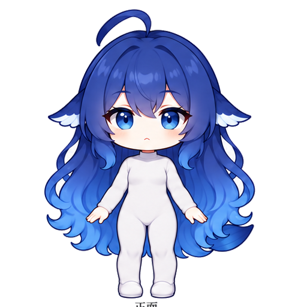
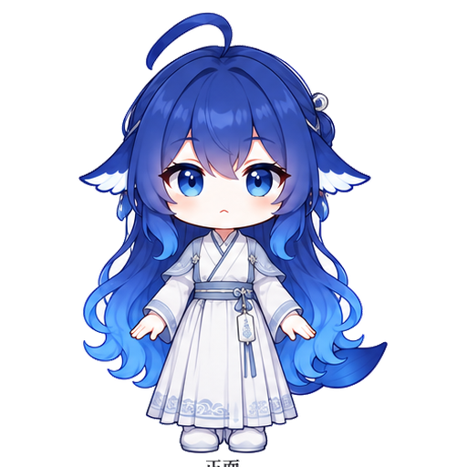

# Moodboard / 情绪板

## 关键词

**深海、夜航、玻璃、奶油纸、蓝鲸、安静的陪伴、Material 的秩序 + Apple 的触感**

## 素材

| 图 | 用途 |
|---|---|
|  | 头像、助手消息、通知 |
|  | 空状态、Onboarding |
|  | 古风皮肤/季节限定 |

## 色彩

```
深海蓝   #1C2C78  ███████
主蓝     #3254B5  ███████
亮蓝     #457FE0  ███████
冰蓝     #92B0DF  ███████
奶油白   #FBF7F4  ███████
珊瑚     #FF8A7A  ███████
金色     #D9A441  ███████
```

## 材质

- 磨砂玻璃：低饱和蓝黑底 + 18–22 blur + 顶部 1px 高光。
- 奶油纸：Light 模式的 surface，不用纯白。
- 金属/金线：只在记忆时间线、重要度、品牌字上点一下，不做大面积金色。
- 水波/鳍：用 SVG path 做极细的分隔线/加载形状，不用大图。

## 排版

- 标题：Noto Serif SC 600，字距略松；只用于品牌和“记忆体”。
- 正文：Noto Sans SC 400/500，行高 1.55；不要用细体。
- 数字/代码：系统等宽；不需要额外字体。

## 参考链接

- RikkaHub（交互，不复制）：https://github.com/rikkahub/rikkahub
- Material 3 Expressive（颜色/形状/动效）：https://m3.material.io/
- Apple Human Interface Guidelines（毛玻璃/层次）：https://developer.apple.com/design/human-interface-guidelines/materials
- 大肥鱼素材与许可：https://github.com/xiaoweigen/deepseek-dafeiyu-assets
